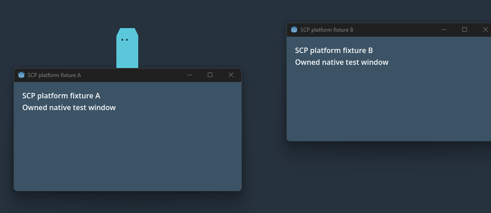

# PLAN-004 — LG 모니터 창 발판·물리 최종 검증

- 실행일: 2026-11-24. 루트 `C:/Dev/scp_desktop`, Windows 11 / Godot 4.7.2 .NET / .NET 8.0.21 / Compatibility / RTX 5070.
- 사용자 요청: PLAN-005를 on hold로 전환하고 PLAN-004를 LG 모니터에서 실행. LG FULL HD의 WMI 제조사 GSM·제품 GSM5BDE를 Win32 DISPLAY2에 대조했다.
- 실제 화면: 1920×1080, 물리 원점(-1920,1061), 작업 영역1920×1032, DPI96. 주 모니터 G34WQC의 설정은 변경하지 않았다. [최종 모니터 증거](monitor.json).
- 대상: 실제 PlatformDesktop → PlatformController → PlatformWorld. 재현 입력과 Win32 관찰은 같은 Observe/Tick/Walk/Jump/Drag 경로를 사용한다. 개체는 48×96 중립 물리 마커이며 SCP-999 개별 AI 통합은 아니다.

## 재현 명령

```powershell
./scripts/godot.ps1 -Action Build
./scripts/godot.ps1 -Action Import
./scripts/godot.ps1 -Action PlatformSmoke -Headless -MonitorId GSM5BDE -EvidenceDirectory docs/plans/evidence/PLAN-004/run-007 -LogFile docs/plans/evidence/PLAN-004/run-007/execution.log
./scripts/godot.ps1 -Action PlatformSmoke -MonitorId GSM5BDE -EvidenceDirectory docs/plans/evidence/PLAN-004/run-008 -LogFile docs/plans/evidence/PLAN-004/run-008/execution.log
```

이미 사용한 증거 경로다. 다음 실행은 새 번호로 지정한다. `PlatformPreview -MonitorId GSM5BDE`는 종료하지 않고 실제 창을 관찰하는 수동 실행 경로다. 모니터 이름이 아니라 검증한 하드웨어 식별자로 선택하며 여러 대/미연결이면 초기 실행을 실패시킨다.

## 실제 결과

- 빌드 경고/오류0, Import 종료0.
- [headless](../run-007/results.json) 36개 통과, [로그](../run-007/execution.log). 모의 음수 좌표/144DPI, 일방향 충돌, 가려짐/z순서, 최대화/비표시/cloaked, 보행/낙하/착지/도약/관성, 숨김/복원/종료, 모니터 제거 복구를 확인했다.
- [LG native](results.json) 54개 통과, [로그](execution.log) 오류0. 실제 DWM 경계→발판, 창 이동→지지 이동/관성, 최소화→바닥 낙하, 복원→인접 창 도약, 앞 창→발판 분할, 최대화→가려진 발판 제거, 종료→지지 해제, 숨김/복원/정리를 확인했다.
- live 컨트롤러의 50ms 관찰과 실제 프레임 갱신을 켠 상태에서도 창 이동이 공통 물리에 반영되는 것을 확인했다. 나머지 native 시나리오는 같은 코드에 시간/관찰을 명시적으로 전달했다.
- body native 좌표를 공통 Foot와 대조하고 화면 픽셀을 확인했다. 창 플래그만으로 표시 성공을 판정하지 않았다. [실제 화면](native-platforms.png).
- [고정 재현 입력](scenario-inputs.json)을 두 번 읽어 같은 초기 상태·명령·시간으로 실행한 [trace](replay-trace.json)가 바이트 단위로 일치했다. [native 입력 관찰](fixture-observations.json)·[native 상태 trace](native-trace.json)는 모의 재현과 구분한다.
- [기존 Main headless 회귀](environment-headless.log) 통과. PLAN-005 기능/아트 수정은 하지 않았고 그 PLAN을 자동 재개하지 않았다.
- 실제 창 시험은 하네스가 만든 native 창만 이동·최소화·최대화·종료했다. 제목/본문 수집 없이 크기·좌표·가시성·순서로 판정한다. 캡처는 LG 화면에 만든 시험 배경/창/마커 영역만 담았다.
- Computer Use는 사용하지 않았다. PowerShell/Godot/Win32 경계로 실행·관찰·시험을 수행했다.

## 회차별 실패와 보완

| 회차 | 결과 |
| --- | --- |
| [001](../run-001/preview.log) | 최초 LG 실시간 실행. monitor=1, origin=(-1920,1061) 확인 |
| [002](../run-002/execution.log) | 인접 도약 착지 실패. 반암시적 적분이 도약 예측 시간보다 일찍 하강 교차하여 좁은 착지 여유를 벗어남 |
| [003](../run-003/execution.log) | 일정 중력의 정확한 위치 적분으로 수정, headless33 통과 |
| [004](../run-004/execution.log) | 시험 창의 Visible 기본값 때문에 ForceNative 설정 오류와 발판 검사 실패 |
| [005](../run-005/execution.log) | Visible=false로 구성 후 표시, native49 통과. 다만 캡처 검수에서 배경이 마커를 가림을 발견해 시각 완료로 판정하지 않음 |
| [006](../run-006/execution.log) | NOACTIVATE로 마커 표시 순서 보완, 화면 픽셀 포함 native50 통과 |
| 007 / 008 | 모니터 복구의 바닥 아래 고착·관성 중복·가로막힌 도약을 보완하고 회귀 추가, 최종36/54 통과 |

## 완료 경계와 한계

- PLAN-004의 창 관찰·공통 발판/물리·단독 실행·모의/실제 검증·입력 재현 범위를 완료했다.
- PLAN-005는 on hold다. 기존 SCP-999의 애니메이션/제스처·Foot·점액 부착을 이 물리 상태에 연결하는 후속 통합은 진행하지 않았다. 현재 물리 마커를 SCP-999 완성품으로 보고하지 않는다.
- DWM 사각 경계를 사용하는 프로토타입이다. 비정형 창·투명 창의 픽셀 단위 가림, 관리자/보호 창의 모든 조합, 가상 데스크톱 전환 실기기, 실제 혼합 DPI, 화면 회전/분리 실기기, 배포/장시간 비용은 미검증이다.
- DWM 실패 시 GetWindowRect로 대체하므로 해당 경우 보이지 않는 resize border 차이가 남을 수 있다. poll 간격50ms 사이의 창 변화를 모두 기록하지 않으며 관측된 변위/현재 유효성으로 처리한다.
- 세션 창 ID는 PID+HWND+관측 generation이다. 소실을 관측한 후 같은 HWND가 재사용되면 새 generation이다. 두 poll 사이에 같은 프로세스가 핸들을 폐기/재사용한 경우 완전한 감지는 보장하지 않는다.
- 선택 모니터에서 동작한다. 모니터 분리 시 남은 화면으로 복구하고 재연결 시 지정 화면을 다시 선택한다. 자동 다중 화면 횡단 AI는 범위 밖이다.
- 프로토타입 조정값과 관성/최대화/가려짐 정책은 [PLAN-004](../../../PLAN-004-window-platforms.md), 구현 결정은 [TECH-009](../../../../decisions/TECH-009-window-platform-physics.md)를 따른다.


