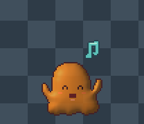
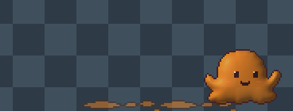

# PLAN-005 단계 B — 제품 행동 적용과 최종 검증

- 날짜: 2026-11-24. 기준 루트 `C:/Dev/scp_desktop`, Windows 11, Godot 4.7.2 .NET / Compatibility / RTX 5070, .NET 8.0.21.
- 대상: 실제 Main → Scp999Controller → Scp999State. Main이 공통 StressState를 소유하고 컨트롤러·하네스가 같은 객체와 명령을 사용한다.
- 제품: 커서 추적·방향 전환, 타이핑 활동 반응, 왼쪽 클릭/문지름, 오른쪽 드래그, 바닥 착지, 하트/음표·점액 수명/상한, 숨김·복원·종료.
- 본체 r005와 반응 r001은 승인본. 점액 r001은 미승인 임시 적용이며 ART-003 완료나 시각 승인으로 처리하지 않았다.

## 명령과 결과

```powershell
./scripts/godot.ps1 -Action Build
./scripts/godot.ps1 -Action Import
./scripts/godot.ps1 -Action Scp999Smoke -EvidenceDirectory docs/plans/evidence/PLAN-005/run-025 -LogFile docs/plans/evidence/PLAN-005/run-025/execution.log
./scripts/godot.ps1 -Action Scp999Smoke -Headless -EvidenceDirectory docs/plans/evidence/PLAN-005/run-026 -LogFile docs/plans/evidence/PLAN-005/run-026/execution.log
```

이미 사용한 출력 경로다. 재실행 시 새 run 번호를 사용한다. 실제 OS 입력 시험은 `-NativeInput`을 추가한다. 소유한 별도 InputProbe 창을 앞에 두고 합성 클릭/F24 활동을 보내며, 포커스 확보 실패 시 입력 전에 중단한다. 키 내용은 수집하지 않는다. 일반 창 검증은 포커스를 요구하지 않는다.

- 빌드 경고/오류 0, Import 종료 코드 0.
- [최종 네이티브 상태 결과](results.json): 66개 통과, [실행 로그](execution.log) 오류 없음. 실제 경과 시간으로 새 반응을 생성하고 1.1초 후 상태와 native 효과 창 제거 확인. 이 회차는 합성 OS 입력을 보내지 않았다.
- [최종 headless 결과](../run-026/results.json): 56개 통과, [로그](../run-026/execution.log). 음수 원점·모의 혼합 DPI·경계 반경240/241px·중복 입력·동시 입력 우선순위·루프/일회·상한·숨김 중 드래그 취소를 포함한다.
- [실제 Windows 입력](../run-021/results.json): 77개 통과, [로그](../run-021/execution.log), [수신기 로그](../run-021/receiver.log), [배치](../run-021/desktop.json). 본체 클릭→공통 스트레스 감소, 모서리/반응/점액/숨긴 본체 클릭→별도 프로세스 수신, 비활성 제품의 타이핑 반응, held 문지름·오른쪽 드래그/해제·실제 커서 추적을 확인했다.
- 실제 환경은 3440×1440(usable 3440×1392)와 음수 X 보조 모니터 1920×1080, 두 화면 96DPI. 이번 실제 입력은 주 모니터에서 수행했다. 혼합 DPI는 모의 좌표 검사이며 실제 혼합 DPI 장비 검증이 아니다.
- [환경 headless](../run-020/environment-headless.log)·[환경 Windows](../run-020/environment-windows.log), [기존 오버레이 23개 회귀](../run-020/overlay-windows.log) 통과. 기존 두 임시 오버레이는 진단 전용이고 제품은 SCP-999를 사용한다.
- [파일 동일성](asset-hashes.json): 런타임 PNG/계약 JSON 10개가 지정 export와 SHA256 일치. [재현 스크립트](verify-assets.ps1), [적용 계약](art-integration.md).

## 실패와 중간 결과

| 회차 | 실제 결과와 처리 |
| --- | --- |
| [015](../run-015/execution.log) | 초기 headless 55개 통과 |
| [016](../run-016/execution.log) | 초기 native 63개 통과. 창 플래그만 확인했고 실제 외부 입력 증거는 아님 |
| [017](../run-017/execution.log) | 실제 효과 클릭이 별도 프로세스에 도달하지 않아 실패. Godot MousePassthrough/HTTRANSPARENT만으로 불충분 |
| [018](../run-018/execution.log) | EnableWindow(false) 대안도 같은 실패. 최종 코드에서 제거 |
| [019](../run-019/execution.log) | WS_EX_LAYERED + WS_EX_TRANSPARENT로 실제 입력은 통과. 숨긴 창에서 DPI를 읽는 진단 오류 때문에 전체 판정 실패. 당시 results.json의 passed만으로 통과로 간주하지 않음 |
| [020](../run-020/execution.log) | DPI를 숨김 전에 읽도록 수정, 71개·오류0. 실제 화면에서 효과 투명 합성도 확인 |
| [021](../run-021/execution.log) | 공통 상태 소유를 Main으로 명확화, 점액을 본체 뒤로 배치, 숨김 중 드래그 취소 및 실제 문지름/드래그/추적 추가. 77개 통과 |
| [022](../run-022/execution.log) / [023](../run-023/execution.log) | 새 재검사에서 Windows foreground 확보 실패. 소유 수신기 이외에 입력을 보내지 않고 중단 |
| [024](../run-024/execution.log) | 초기화 대기 후에도 foreground 거부. 환경 실패로 보존. 기본 검사와 명시적 NativeInput 검사를 분리 |
| 025 / 026 | 최종 일반 native66/headless56 통과. 021의 실제 입력 증거를 재사용하며 새로운 입력 성공으로 주장하지 않음 |

## 제한과 남은 작업

- PLAN-004 미구현: 현재는 작업 영역 바닥에서 움직인다. takeoff/fall/land/balance/balance_recover의 상태→태그 계약은 검사했지만 실제 창 열거·중력·발판 이동/소멸·관성·점액 부착은 구현/검증되지 않았다. PLAN-005는 active 유지.
- 173/049 제품 개체가 없어 상호 작용 대상은 하네스가 실제 공통 StressState에 등록했다. 개별 AI나 스트레스 UI를 만들지 않았다.
- 조명은 승인된 진단 파라미터의 고정 주광원이다. 실제 시간/태양·제품 전체 성능·16개 효과 최악 조건 비용·배포 내보내기는 이번에 측정하지 않았다.
- native 효과는 생성/소멸 시 창을 만들고 정리한다. 기본 간격/거리와 상한으로 제한하며 풀링은 도입하지 않았다.
- 타이핑은 WH_KEYBOARD_LL의 key-down 메시지 종류만 병합한다. 키 데이터 포인터·문자열·키 식별자는 읽거나 저장하지 않는다. 숨김/종료 시 hook을 해제한다.
- 이 회차는 Computer Use를 사용하지 않았다. Godot/PowerShell/Win32 진단으로 실행·입력·스크린 영역 검증을 했다. 캡처 영역은 소유한 체크 배경과 제품 표시로 한정했다.




